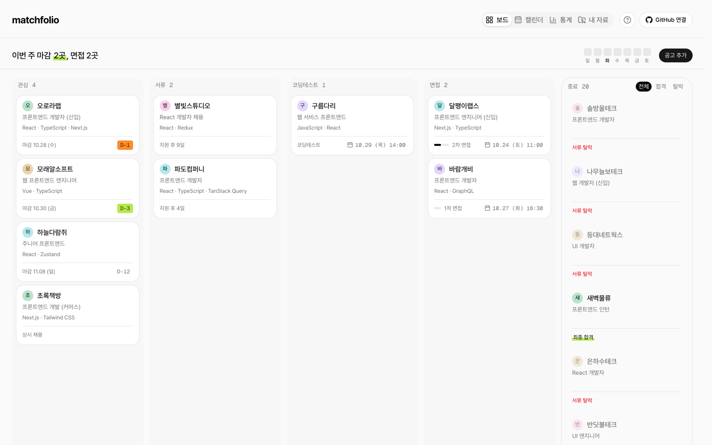
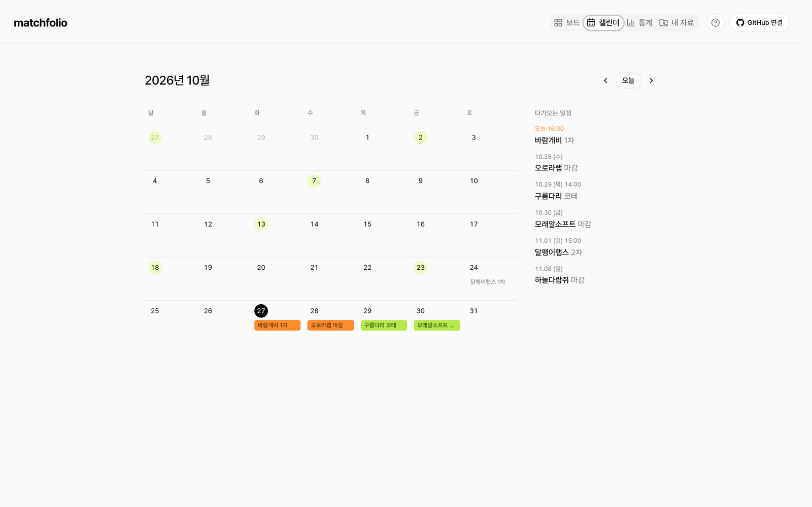
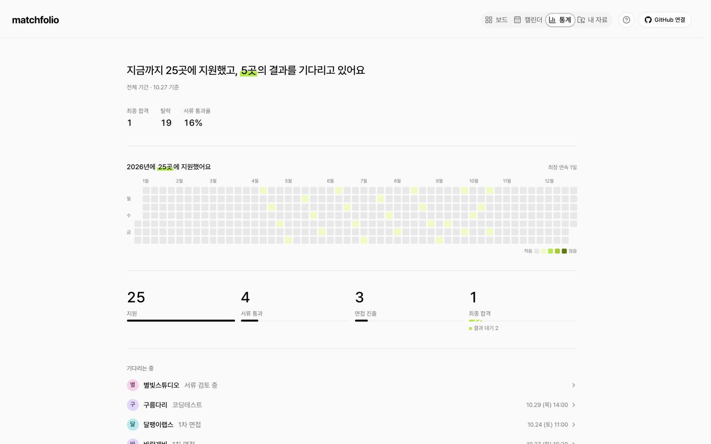
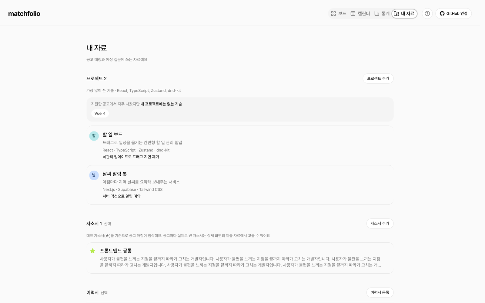
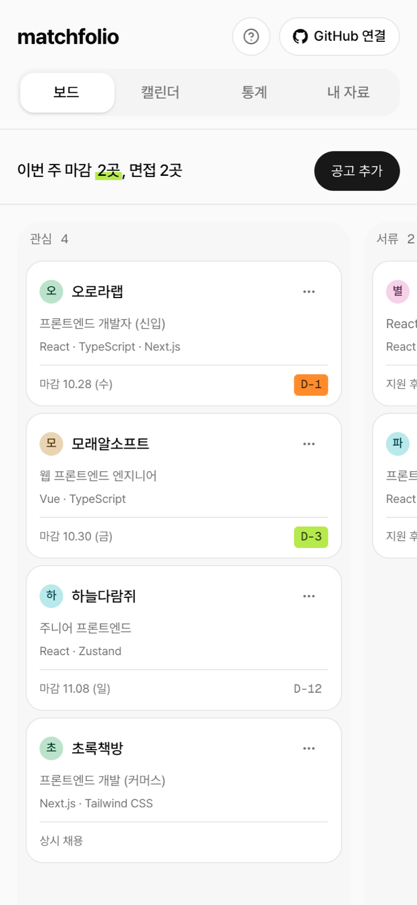

# matchfolio

채용공고 스크린샷 한 장으로 지원 현황을 관리하는 칸반보드

공고를 캡처해서 붙여넣으면 AI가 회사명·직무·마감일·기술스택을 읽어 카드를 만들어 줍니다. 관심 공고부터 서류·코딩테스트·면접·결과까지 한 보드에서 관리하고, 내 프로젝트·자소서를 공고에 맞춰보고, 면접 예상 질문까지 준비할 수 있습니다.

🔗 **https://matchfolio-omega.vercel.app** — 회원가입 없이 바로 써볼 수 있습니다



## 왜 만들었나

프론트엔드 신입으로 취업을 준비하며 지원한 곳을 스프레드시트로 관리했는데, 공고마다 회사명·마감일·기술스택을 옮겨 적는 게 귀찮아서 결국 안 쓰게 됐습니다. 원티드·사람인 같은 사이트는 복사가 막혀 있는 경우도 많았습니다.

그래서 "**입력이 귀찮으면 아무도 안 쓴다**"를 기준으로 삼았습니다. 로그인 화면도, 입력 폼부터 채우는 단계도 없이 스크린샷 한 장으로 시작합니다.

## 주요 기능

| 기능                   | 설명                                                                                                              |
| ---------------------- | ----------------------------------------------------------------------------------------------------------------- |
| 스크린샷으로 공고 추가 | 캡처를 끌어다 놓거나 ⌘V로 붙여넣으면 Gemini 비전이 공고를 읽어 폼을 채웁니다. 저장 전 사용자가 확인·수정합니다.   |
| 칸반보드               | 관심 → 서류 → 코딩테스트 → 면접 → 종료. 드래그로 단계를 옮기고, 면접은 차수별로 일정을 쌓습니다.                  |
| 캘린더                 | 관심 공고 마감일과 코딩테스트·면접 일정을 한 달 단위로. 마감 임박은 색으로 구분합니다.                            |
| 통계                   | 지원 잔디, 단계별 통과 퍼널, 공고에서 자주 요구하는 기술.                                                         |
| 공고 매칭              | 내 프로젝트·자소서·이력서를 공고와 비교해 적합도, 어필할 프로젝트, 자소서 첨삭, 지원 동기 포인트를 만들어 줍니다. |
| 회사 분석 · 예상 질문  | 웹 검색으로 회사 사업·최근 소식을 정리하고, 공고와 내 프로젝트를 바탕으로 면접 예상 질문·역질문을 만듭니다.       |
| 로그인 없이 시작       | 익명 계정으로 바로 쓰고, 원하면 GitHub를 연결해 다른 기기에서도 같은 보드를 엽니다.                               |

| 캘린더                                                        | 통계                                                          |
| ------------------------------------------------------------- | ------------------------------------------------------------- |
|  |  |

| 내 자료                                                        | 휴대폰                                                                          |
| -------------------------------------------------------------- | ------------------------------------------------------------------------------- |
|  |  |

## 기술 스택

| 분야       | 사용 기술                                                                     | 선택 이유                                                                                |
| ---------- | ----------------------------------------------------------------------------- | ---------------------------------------------------------------------------------------- |
| 프레임워크 | Next.js 16 (App Router), React 19, TypeScript                                 | 서버 컴포넌트로 첫 화면 데이터를 바로 그리고, AI 호출은 API 라우트에서 키를 숨긴 채 처리 |
| 스타일     | Tailwind CSS 4, shadcn/ui (Radix)                                             | 컴포넌트 코드를 직접 가져와 고칠 수 있어서 모달·메뉴 동작을 프로젝트에 맞게 커스터마이징 |
| 백엔드     | Supabase (Postgres, Auth, Storage)                                            | 별도 서버 없이 인증·DB·파일 저장. 행 단위 보안(RLS)으로 사용자 데이터 격리               |
| AI         | Gemini flash (이미지 읽기), Groq gpt-oss-120b (텍스트 생성), Tavily (웹 검색) | 무료 한도 안에서 쓸 수 있는 조합. 한국어 공고 이미지는 Gemini가 가장 정확했음            |
| 드래그     | dnd-kit                                                                       | 마우스·터치 센서를 따로 설정할 수 있어 휴대폰에서 스크롤과 드래그를 구분                 |
| 애니메이션 | Framer Motion                                                                 | 사용법 튜토리얼의 움직이는 미니 화면                                                     |
| 테스트     | Vitest                                                                        | 드래그 단계 변경 규칙, AI 응답 정규화, 적합도 계산 등 핵심 로직 290개                    |
| 배포       | Vercel                                                                        |                                                                                          |

### 폴더 구조 — Feature-Sliced Design

```
src/
├── app/        # 라우트, API 라우트
├── widgets/    # 화면 단위 묶음 (칸반보드, 캘린더, 통계, 내 자료)
├── features/   # 사용자 동작 (공고 추출, 공고 매칭, 회사 분석, GitHub 연결 …)
├── entities/   # 도메인 모델과 API (지원 카드, 일정, 프로젝트, 문서)
└── shared/     # UI 컴포넌트, Supabase 클라이언트, 유틸
```

## 고민한 것들

**AI가 지어낸 값을 채우느니 실패를 알린다**
처음엔 Gemini가 실패하면 다른 비전 모델로 넘어가게 했는데, 그 모델이 한국어 공고를 못 읽고 그럴듯한 회사명과 기술스택을 지어냈습니다. 틀린 값이 조용히 저장되는 게 실패보다 나쁘다고 보고 폴백을 없앴습니다. 지금은 Gemini 모델끼리만 넘어가고, 전부 실패하면 "직접 입력하기"로 안내합니다. 세로로 긴 전체 페이지 캡처는 글자가 작아져 내용을 지어내는 원인이 되어, 여러 조각으로 잘라 보냅니다.

**적합도는 AI가 아니라 계산으로**
공고 매칭의 적합도를 AI 점수로 받으면 매번 다르고 근거가 없었습니다. 공고 기술스택과 내 프로젝트 기술스택이 겹치는 비율로 계산하고, AI는 그 근거를 문장으로 풀어 쓰는 데만 씁니다. AI 응답 중 "~를 강조할 수 있습니다" 같은 막연한 조언이나, 고친 문장 없이 설명만 하는 첨삭은 서버에서 걸러냅니다.

**로그인 화면 없이, 하지만 남용은 막게**
첫 방문자는 Supabase 익명 계정으로 바로 시작합니다. 계정마다 AI 하루 한도가 있어서, 봇이 계정을 무한히 만들어 한도를 우회하지 못하게 Cloudflare Turnstile을 통과해야만 계정이 만들어집니다. 한도 확인과 차감은 SQL 함수 하나로 원자적으로 처리하고, AI 호출이 실패하면 돌려줍니다.

**휴대폰에서 끌기와 스크롤이 겹침**
휴대폰에서는 카드가 화면을 거의 덮어서, 카드를 끌려는 동작과 보드를 넘기려는 동작이 겹쳤습니다. 카드에서 스크롤을 막으면 화면이 안 넘어가고, 바로 끌리게 하면 넘기려다 카드가 끌려갔습니다. 스크롤은 그대로 두고, 터치는 0.25초 길게 눌러야 끌리도록 dnd-kit 센서를 마우스·터치로 나눴습니다.

**공용 컴퓨터에서도 안전하게**
처음엔 GitHub 로그인이 브라우저에 남아 있으면 묻지 않고 통과했고, 사이트 로그인도 400일 유지돼서 공용 컴퓨터라면 다음 사람이 내 보드에 들어올 수 있었습니다. 매번 계정 선택 화면을 띄우고, 로그인은 기본적으로 브라우저를 닫으면 끝나게 바꿨습니다. 계정 메뉴에서 "로그인 유지"를 켠 사람만 오래 유지됩니다. `@supabase/ssr`이 쿠키 만료일을 항상 400일로 덮어써서, 쿠키를 쓰는 세 곳(proxy·서버·브라우저)에서 직접 만료일을 떼어 해결했습니다.

**무료 한도 안에서 버티기**
Groq는 분당 토큰 한도가 입력과 최대 출력 토큰을 합쳐 계산돼서, 검색 본문 길이와 출력 길이를 제한했습니다. 가장 먼저 바닥나는 Tavily 검색은 같은 검색어 결과를 사용자끼리 캐시로 공유합니다. 사용자별 AI 결과는 공유하지 않습니다.

그 밖에 hover·선택·로딩·데이터 유무가 바뀌어도 요소의 크기와 위치가 흔들리지 않게 하는 걸 디자인 원칙으로 지켰습니다.

## 개발 방식

[Claude Code](https://claude.com/claude-code)로 개발했습니다. 기능과 디자인 기준을 [AGENTS.md](AGENTS.md)에 명세로 쌓아 AI가 같은 기준으로 작업하게 했고, 결과물은 실제 공고와 휴대폰으로 직접 써보며 검증했습니다.
